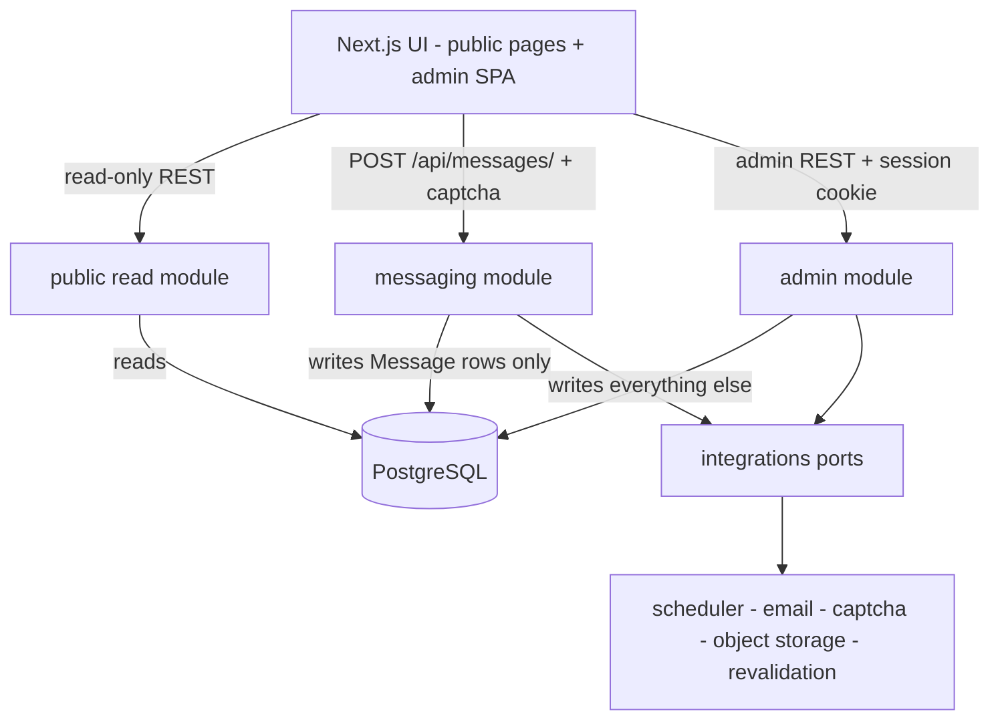
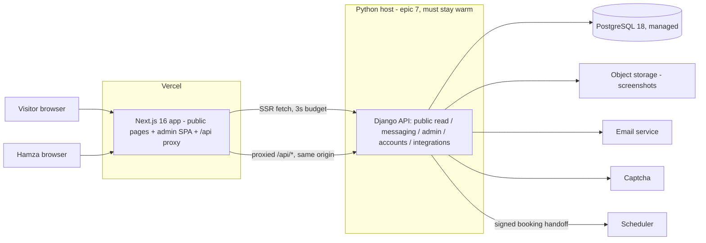
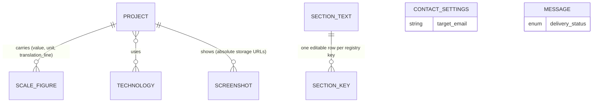

# Architecture Spine — Software Engineer Portfolio

## Design Paradigm

**Modular monolith** (AD-4). One Django application divided into modules with a strict dependency rule, fronted by a Next.js UI deployable that owns no data and never touches the database:

- **public read** — read-only REST endpoints serving the visitor-facing site (projects, sections, reviews, guarantee).
- **messaging** — the contact-message intake, its delivery status, and the inbox read endpoints. Home of the public surface's *only* write endpoint.
- **admin** — authenticated endpoints through which every other DB write flows (projects, sections, settings).
- **accounts** — single-user session auth (`/api/auth/*`).
- **integrations** — ports + adapters for the outside services (scheduler, email, captcha, object storage, revalidation). Vendors never leak past these ports (AD-9).



## Invariants & Rules

### AD-1 — One codebase, one database

- **Binds:** all epics
- **Prevents:** split security surfaces, doubled hosting cost against RULE-7, competing sources of truth for projects, section text and the contact email
- **Rule:** one repository, one Django application, one PostgreSQL database. The database is the single source of truth for projects, section text and the contact target email. *(Amended by AD-5: "one deployable" no longer holds — the UI is a second deployable; the single codebase and single database still bind.)*

### AD-2 — The write rule

- **Binds:** contact-form epic, booking epic, admin epic, foundation epic
- **Prevents:** untracked public write paths into the site DB, booking data duplicated into local tables, admin logic living in the UI, two modules writing the same table
- **Rule:** one writing *deployable* (Django) and one authorization surface. Within Django, each module owns writes to its own tables: `messaging` writes messages, `admin` writes projects/sections/settings, `accounts` writes users. The public surface has exactly one write endpoint — the captcha-guarded contact intake `POST /api/messages/` — and no other public endpoint may mutate state. Every other write goes through authenticated admin endpoints. A booking never touches the DB — it lives in the scheduler (with a signed handoff through Django, see AD-9). The UI never writes the database.

### AD-3 — Minimal read-only messages inbox

- **Binds:** admin epic, contact-form epic
- **Prevents:** stored messages being unreadable without raw DB access; scope creep toward a mail-client (no reply, no workflows)
- **Rule:** the admin area includes a simple read-only list of stored messages (sender, time, body, delivery status). Nothing beyond listing. *(Deliberate scope addition beyond FR-11/FR-12 — folded into the admin epic's Done when on 2026-11-22 when the spine was adopted as the epics' companion.)*

### AD-4 — Modular monolith with inward-only dependencies

- **Binds:** all epics
- **Prevents:** cross-module reach-in, hand-rolled vendor calls outside the integration ports, public code growing write paths
- **Rule:** the Django modules — public read, messaging, admin, accounts, integrations — keep the dependency rule: feature modules may use integrations; integrations never reach back into feature modules. The UI talks only to the API over HTTPS.

### AD-5 — Stack: Next.js + Django

- **Binds:** all epics
- **Prevents:** the frontend fetching the DB directly, a third app appearing, per-epic framework choices
- **Rule:** public pages and the admin SPA are one Next.js application; Django 6.1 + DRF is the JSON API and the only database accessor; PostgreSQL is the data store. The frontend host is Vercel as the owner-proposed working assumption, ratified by the launch epic (which owns hosting per the ticket; a non-commercial ToS clause on the Hobby plan is a known tradeoff for a client-soliciting site).

### AD-6 — Admin auth is a Django session cookie; one public origin

- **Binds:** foundation epic (owns the whole auth surface), admin epic (consumes it)
- **Prevents:** tokens in JS-readable storage, hand-rolled CSRF, per-epic auth inventions, CORS built twice or not at all
- **Rule:** the site has **one public origin**: browser calls to `/api/*` are proxied by Next.js to the Django host (no CORS), while server-side SSR fetches go direct to the API base URL. Auth is Django's session framework: httpOnly, Secure, SameSite=Lax cookie + Django CSRF. The foundation epic owns the auth surface as JSON endpoints in `accounts` (`/api/auth/login`, `/api/auth/logout`, `/api/auth/session/`), the CSRF cookie handoff, the CORS/CSRF env configuration, the API base-URL env var names (`NEXT_PUBLIC_API_BASE_URL` in `web/`), and disables Django's built-in admin site. The admin SPA consumes these endpoints and never implements auth logic. Only Hamza authenticates (FR-15).

### AD-7 — RULE-5's second channel: delivery status, owned by messaging

- **Binds:** contact-form epic, booking epic, admin epic
- **Prevents:** silently swallowed send failures, two notification architectures for bookings, per-epic status-field inventions, an unprompted second alerting service
- **Rule:** every email send records a delivery status: a single `delivery_status` field on `messaging.Message`, enum `pending | sent | failed`, owned and written only by the `messaging` module; the admin inbox renders it read-only. `pending` is the initial state on intake; no automatic retry in MVP. Booking notifications are sent by the booking epic through the shared email port (AD-9); scheduler-native confirmation emails are supplementary and out of RULE-5's scope. A failed send appears marked in the inbox **and** triggers a best-effort failure alert through an independent secondary channel (a separate email account); if that also fails, the inbox row is the record.

### AD-8 — Media lives in object storage; the port exists before it's needed

- **Binds:** foundation epic (provisions), admin epic (vendor + upload path), project-proof epic (consumes URLs)
- **Prevents:** screenshots vanishing on redeploy (ephemeral free-host disks), the proof epic deadlocking on a vendor the deferral hadn't resolved, the SPA holding storage credentials, unbounded uploads
- **Rule:** object storage is provisioned as part of the foundation scaffold — an `object-storage` port in `integrations` with a local/dev adapter; the admin epic picks the vendor and fills credentials into the existing port, and the choice must be resolved before the launch content is served from production. *(Amended 2026-11-22, found by the tree check at companion adoption: the original "resolved before epic 3's content seed" contradicted the epic order — epic 6 is gated by epic 3. Epic 3's launch seed runs on the dev/local adapter; epic 6's vendor pick migrates the stored content; epic 7 verifies the swap in production.)* Screenshots are stored as absolute public `https://` URLs; uploads go multipart through the Django admin module only (the SPA never holds storage credentials); max upload size is fixed at scaffold time (default 10 MB), enforced at the API layer. Nothing user-uploaded persists on the API server's local disk.

### AD-9 — One adapter per shared vendor; the captcha verifies server-side

- **Binds:** contact-form epic, booking epic, admin epic, foundation epic
- **Prevents:** duplicate adapters per epic, two captchas on two forms, parallel email vendors, a rogue second public write endpoint for bookings, client-side-only guard checks
- **Rule:** one email service, one captcha vendor, one scheduler — each behind exactly one integration port (AD-4). The booking epic reuses the contact epic's email adapter and the shared captcha; it never adds its own. The captcha port exposes a **Django-side token verification**: the SPA obtains a token, Django verifies it server-side at the intake / booking handoff, and only then does the booking handoff proceed (a short-lived signed handoff to the scheduler API — the scheduler's native anti-spam is supplementary and out of RULE-6's scope). The captcha site key is served to the SPA via one public config endpoint owned by the foundation epic; the secret key is a Django env var only.

### AD-10 — Content freshness contract across the two deployables

- **Binds:** foundation epic (builds the plumbing), admin epic (calls it), home-trust / project-proof / contact-form epics (extend the path map)
- **Prevents:** stale proof after an admin edit — the site's core promise is current content; the webhook halves being built twice or not at all; "affected pages" having no owner
- **Rule:** public pages are server-rendered by Next.js from the Django API, with a short time-based revalidate window (60 s) as fallback. The revalidation plumbing is one deliverable owned by the **foundation epic**: (a) a token-protected revalidation route in `web/`, (b) a `revalidation` port in the Django `integrations` module with a no-op dev adapter, (c) a single page-path map in `web/` keyed by content entity (`section:<key>`, `project:<slug>`). Admin epics only call the port after a successful save; feature epics extend the path map when they add pages. The webhook secret is an env var on both deployables, documented by foundation.

### AD-11 — SSR fetch budget and degradation

- **Binds:** foundation epic (builds the fetch layer), home-trust and project-proof epics (consume it), launch epic (warmth)
- **Prevents:** a slow or cold Django stalling first meaningful paint past RULE-4; two page owners inventing different degradation behavior; per-page fetch workarounds
- **Rule:** all server-side fetches from Next.js to Django go through one shared data-fetch layer built by the foundation epic, with a fixed per-request timeout (3 s) and one degradation rule: serve last-good cached content, never block first paint on a vendor call (scheduler, analytics). Keeping Django warm — uptime target, keep-alive mechanism, monitoring — is a launch-epic deliverable (see AD-12); no other epic adds per-page workarounds.

### AD-12 — Operational envelope: environments, backups, monitoring, availability

- **Binds:** all epics; launch epic owns verification
- **Prevents:** epics assuming a staging environment exists, silent data loss, the conversion path's availability never being measured, dead infrastructure alarms
- **Rule:** environments are **dev + prod only**; deploy = merge to main. Backups: the managed Postgres provider's automated daily backups, with one restore tested before launch. Monitoring: a free uptime monitor on the Django API and the conversion paths, the failed-delivery rows in the inbox (AD-7), and Vercel Web Analytics for traffic/conversions. The conversion path (booking + contact form) carries a **99% monthly availability** target — downtime there is lost clients; the number is this spine's threshold, set per the PRD's mandate.

## Consistency Conventions

| Concern | Convention |
| --- | --- |
| Naming | Django apps: `projects`, `content`, `messaging`, `integrations`, `accounts`. API resources: plural nouns (`/api/projects/`, `/api/sections/`, `/api/messages/`, `/api/auth/*`). Frontend components PascalCase; routes lowercase-kebab (`/projects/[slug]`). |
| Data & formats | Project identity = **slug, immutable after creation**; editing a display name never changes the URL. Dates: ISO 8601, stored UTC. Money never appears in the data model (non-goal). Every scale figure is a *(value, unit, translation_line)* triple — a number without its translation line cannot be represented (RULE-1 by construction). A project carries either a public `repo_url` or a non-empty `no_repo_reason` (validation-enforced; FR-4); `live_url` optional. |
| Canonical schemas | **One canonical Project JSON schema** lives in the Django repo (serializer + contract snapshot test), owned by the project-proof epic; admin endpoints consume and produce the same representation, extended — never forked — by the admin epic. Technologies are objects `{name, slug}`; every screenshot is an absolute `https://` URL; `translation_line` is non-nullable end-to-end. |
| Section text | All home-page section keys are defined in a **single section-key registry** created and owned by the home-trust epic and seeded into the `content` module — including the contact section's shell and editable copy. Later epics reference existing keys; adding a key means extending the registry, never creating an ad-hoc row. The honest-launch message and the guarantee copy are `content`-module rows seeded by the home-trust epic and edited by the admin epic. **No visitor-visible copy on the home scroll may be hardcoded in `web/`.** |
| Contact target | The contact target email lives **only** in the database (`CONTACT_SETTINGS`, single row), seeded by a migration owned by the contact-form epic; the contact epic owns the read, the admin epic owns the edit endpoint. Env vars hold credentials and secrets only — never editable business config. A missing settings row is a startup error in Django, never a silent fallback address. |
| Errors | One JSON envelope for every API error: `{error: {code, message}}` [ASSUMPTION — safe default, not explicitly confirmed]. The **error-code registry** (a constant table in the Django repo, mirrored in `web/`) is owned by the foundation epic; new codes are added there, never inline. |
| Analytics events | Event names are defined by the foundation epic (`conversion_contact`, `conversion_booking`), emitted from the SPA at the confirmation screens through one helper the foundation epic ships. |
| Env vars | The foundation epic owns a single `.env.example` listing every variable with its owner epic and consumer deployable; epics extend it, never shadow it. Secrets via environment variables, never committed. |
| State & cross-cutting | Auth: Django session only (AD-6). Writes are authorized at the API layer, never by UI hiding alone. The captcha check is the single guard check on the booking and form paths (RULE-6); the guard adds no further friction. Mobile-first rendering with an equivalent desktop experience (C9); UJ-3 happens on a phone. RULE-3 (the call is free, no commitment beyond it) lives in scheduler configuration and site copy, not in code. |

## Stack

| Name | Version |
| --- | --- |
| Python | 3.13 (deliberate: widest library/wheel support among Django 6.1's supported versions) |
| Django | 6.1.x (6.1.3) |
| Django REST Framework | 3.18.x (3.18.3) |
| PostgreSQL | 18 (managed provider; Django 6.1 floor is 15) |
| React | 19.3.x (19.3.1) |
| Next.js | 16.4.x (16.4.6 — carries the Oct/Nov 2026 security fixes; 16.3 is unpatched) |
| Node.js | 26 LTS (Lithium) |
| Frontend host | Vercel Hobby — owner-proposed, ratified by epic 7 |
| Analytics | Vercel Web Analytics (cookieless; keeps R13) |

## Structural Seed

Deployment topology (the specific Python host is epic 7's, under AD-11/AD-12's warm-API and availability constraints):



Core entities (names + relationships; an attribute that is itself an invariant is an AD or a convention, not a diagram):



Minimal source tree:

```text
portfolio/
  web/            # Next.js 16: public pages, /admin SPA, revalidation route, path map
  api/            # Django project
    config/       # settings, urls, env template
    projects/     # module: projects, scale figures, technologies, screenshots
    content/      # module: section text, reviews message, guarantee copy
    messaging/    # module: contact intake, delivery status, inbox reads
    accounts/     # module: /api/auth/*, single-user session auth
    integrations/ # ports + adapters: scheduler, email, captcha, object storage, revalidation
```

## Capability → Architecture Map

| Capability / Area | Lives in | Governed by |
| --- | --- | --- |
| R1 (first-screen trust: photo, claim, presence cue) | Next.js public pages + `content` rows | AD-5, AD-10, AD-11 |
| R2 (gallery tile → project page; translation lines) | `projects` module + project pages | AD-1, canonical-schema convention |
| R3 (evidence, technologies, live URL, repo link or stated reason) | `projects` module + project pages | AD-1, data conventions (repo_url / no_repo_reason) |
| R4 (booking + spam guard, demonstrable) | Booking handoff through `integrations` ports | AD-2, AD-9, AD-12, RULE-6 |
| R5 (contact form → email, instant confirmation) | `messaging` module + email port | AD-2, AD-7, AD-9, RULE-5 |
| R6 (reviews section, honest launch message) | `content` rows + home page | AD-1, section-key convention, RULE-2 |
| R7 (30-day guarantee in writing) | `content` rows | AD-1, section-key convention |
| R8 (intro video before conversion point) | Next.js public pages | AD-5, AD-11 (video never blocks first paint) |
| R9 (launch gallery ≥1 real project; grows via admin) | `projects` seed (epic 3) + admin CRUD (epic 6) | AD-1, AD-2, AD-8 |
| R10 (admin: projects CRUD) | Next.js `/admin` SPA + `admin` module | AD-2, AD-3, AD-8, AD-10 |
| R11 (admin: contact target + section text) | `admin` module + `content`/`CONTACT_SETTINGS` rows | AD-1, contact-target convention, AD-10 |
| R12 (only Hamza, authenticated) | `accounts` module | AD-6 |
| R13 (basic analytics) | Vercel Web Analytics + event registry | AD-5 stack row, analytics-events convention |

## Deferred

| Decision | Deferred to | Why it can wait |
| --- | --- | --- |
| Python/Django hosting provider + hosting region | launch epic (epic 7, per ticket Q4) | Owner deferred hosting until after the build; AD-11/AD-12 fix the warm-API, availability and backup constraints it must satisfy. RULE-7's cost **ceiling number** is *not* fixed here — it stays with the owner (Q9) and is needed at this decision |
| Vercel ratification | launch epic | Owner-proposed working assumption; the Hobby plan's non-commercial ToS clause is a known tradeoff to weigh at ratification |
| Email service vendor (Q3) | contact-form epic | The port (AD-9), delivery-status rule (AD-7) and contact-target convention are fixed; the vendor choice doesn't change any other epic |
| Captcha vendor | contact-form epic | Same: one port, one vendor, shared with booking (AD-9) |
| Scheduler vendor + API shape | booking epic | Third-party scheduler decided at initiative level; which one, and its booking-API handoff details, are local to the port |
| Media-storage vendor | admin epic (epic 6) picks; epic 3 seeds on the dev/local adapter until then | AD-8 fixes the port, upload path and size cap; Cloudinary or Supabase Storage both satisfy it (note: Supabase free DBs pause after a week's inactivity — a warm-API trap for the Postgres choice too). Amended 2026-11-22 — the original "resolved before epic 3's seed" contradicted the epic order; the swap is verified at epic 7 |
| Message retention period + EU/privacy statement (OQ-5) | before launch, owner | Stored messages are personal data; a purge default (e.g. 90 days) vs keep-forever, plus the privacy statement and hosting region, must be answered before launch; blocks nothing in the build |
| Deep SEO work beyond SSR | version 1.1 | SSR already covers the launch bar; revisit only if organic search proves to matter |
| Leanness fallback trigger (OQ-7) | MVP planning / owner | A fallback, not a decision |
| Exact DRF/patch pins at scaffold | foundation epic | Seed pins the line (3.18.x); the scaffold locks the patch |
